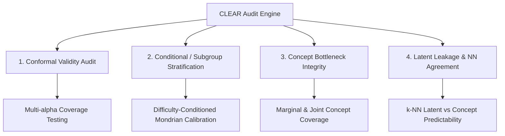

# 🛡️ CLEAR: Conformal LEAkage and Reliability Audit

**CLEAR** is a comprehensive auditing protocol designed to evaluate and certify Concept Bottleneck Models for safety-critical deployment.

---

## 🔍 Core Audit Dimensions

### 1. Multi-Alpha Conformal Validity
Evaluates empirical coverage across multiple risk levels $\alpha \in \{0.01, 0.05, 0.10, 0.20\}$:
$$
\text{Gap}(\alpha) = \frac{1}{N}\sum_{i=1}^N \mathbb{I}(Y_i \in C_\alpha(X_i)) - (1 - \alpha)
$$
A calibrated model must strictly maintain $\text{Gap}(\alpha) \ge -\epsilon$ (where $\epsilon$ is within finite-sample binomial sampling noise).

### 2. Difficulty-Stratified Conditional Coverage
Partitions the test population into Difficulty Strata (Easy, Medium, Hard) using concept prediction entropy:
$$
H(c_i) = -\frac{1}{K}\sum_{j=1}^K \left[ p_{ij}\log p_{ij} + (1-p_{ij})\log(1-p_{ij}) \right]
$$
Ensures that hard instances are not systematically failing the coverage guarantee while easy instances produce tight singleton sets.

### 3. Concept Bottleneck Integrity & Joint Coverage
Audits the hyper-box concept prediction sets $C_C(X) = \prod_{j=1}^K C_j(X)$:
$$
P\left( \forall j \in \{1,\dots, K\}, c_j^* \in C_j(X) \right) \ge 1 - \alpha_{\text{joint}}
$$
Allows provably safe propagation through the downstream model $g_y$.

### 4. Nearest Neighbor Leakage Metric
Measures if intermediate representations $z$ encode residual information about task $y$ that bypasses $c$:
$$
\text{Leakage Gap} = \text{Acc}_{\text{kNN}}(z \to y) - \text{Acc}_{\text{kNN}}(c \to y)
$$
A high leakage gap indicates that the concept bottleneck is leaky and intervention decisions may not behave as intended.

---

## 🔗 Related Notes
- [[00 - Dashboards/Audit Dashboard|Audit Dashboard]]
- [[03 - Experiments/CLEAR_Audit_Shapes3D|Shapes3D Audit Results]]
- [[01 - Literature & Theory/Conformal Prediction Foundations|Conformal Prediction Theory]]
- [[01 - Literature & Theory/Leakage One-Sided Claim|Leakage: the One-Sided Claim]] — the precise (one-sided) leakage logic behind the CLeaR paper
- [[06 - Papers & Planning/Paper Split - CLeaR vs CVPR|Paper Split: CLeaR vs CVPR]]
