# 🏗️ Conformal Concept Models Pipeline Architecture

```mermaid
flowchart LR
    subgraph InputSpace [Raw Input Space]
        X[Input Image X]
    end

    subgraph FeatureBottleneck [Representation & Concept Layer]
        Enc[Feature Backbone: Conv / ResNet]
        Z[Latent Representation z]
        ConceptHead[Concept Head: Linear + Sigmoid]
        C_Pred[Predicted Concepts c]
    end

    subgraph InterventionLayer [Budgeted Intervention]
        Policy{Policy Selection}
        Oracle[Oracle / Expert Feedback]
        Intervened_C[Intervened Concepts c*]
    end

    subgraph DownstreamTask [Task Predictor]
        TaskHead[Task Head: Linear / MLP]
        Logits[Task Logits Y]
    end

    subgraph ConformalCalibration [Conformal Calibration Engine]
        Scores[Nonconformity Scores: Softmax / APS / RAPS]
        Quantile[Finite-Sample Quantile Calculation]
        PredSet[Conformal Prediction Set C_Y]
    end

    X --> Enc --> Z --> ConceptHead --> C_Pred
    C_Pred --> Policy
    Policy -.->|Select Budget k| Oracle
    Oracle -.->|Set Interventions| Intervened_C
    C_Pred --> Intervened_C
    Intervened_C --> TaskHead --> Logits
    Logits --> Scores --> Quantile --> PredSet
```

---

## 📦 Core Component Modules

1. **`ccm.conformal`**:
   - `ConformalCalibrator`: Standard split conformal prediction for task & concept sets.
   - `MondrianConformalCalibrator`: Group- and difficulty-stratified calibration.
2. **`ccm.scores`**:
   - `APSScore`, `RAPSScore`, `SoftmaxScore`, `MarginScore`, `NormalizedScore`, `ConceptResidualScore`.
3. **`ccm.sets`**:
   - `PredictionSet`, `ConceptPredictionSet`, `propagate_concept_sets_to_task`.
4. **`ccm.interventions`**:
   - `RandomInterventionPolicy`, `UncertaintyInterventionPolicy`, `GreedyConformalInterventionPolicy`, `OracleOptimalInterventionPolicy`.
5. **`ccm.models`**:
   - `ConceptBottleneckModel`, `SampleDifficultyEstimator`.
6. **`ccm.data`**:
   - `Shapes3DDataset`, `CUBDataset`.

---

## 🔗 Related Notes
- [[02 - Architecture & System/Nonconformity Scores|Nonconformity Scores]]
- [[02 - Architecture & System/Intervention Policies|Intervention Policies]]
- [[Home|Vault Home]]
