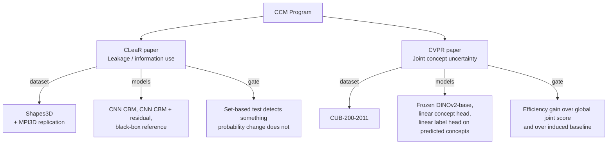

# ✂️ Paper Split: CLeaR vs CVPR

One research program, **two papers with disjoint questions**. Neither subsumes the other; the split below is settled.

## 1. The split

| | **CLeaR** | **CVPR** |
| :--- | :--- | :--- |
| **Question** | Does the predictor use information outside the declared concepts? | Can we quantify uncertainty over the whole concept vector efficiently? |
| **Dataset** | Shapes3D (replicate on MPI3D; factor list to verify) | CUB-200-2011 |
| **Concepts** | Five factors as categorical concepts; the sixth (a background hue) is the hidden nuisance $U$ | 112 class-denoised attributes (primary), 312 raw (secondary) |
| **Models** | CNN CBM; CNN CBM with residual channel; black-box reference | Frozen DINOv2-base; linear concept head; linear label head on predicted concepts |
| **Gate** | A diagnostic that adds something beyond ordinary sensitivity | An efficiency gain beyond a global joint score and beyond the induced baseline |

Theory each paper leans on:

- CLeaR → [[01 - Literature & Theory/Leakage One-Sided Claim|Leakage: the One-Sided Claim]]
- CVPR → [[01 - Literature & Theory/Joint Concept Coverage|Joint Concept Coverage]]

## 2. Explicitly out of scope (first study)

- **Matryoshka / nested concept budgets** (arXiv:2605.20612). It answers a *concept-budget* question, and its label sets are not comparable with concept-vector sets. Kept out of the first study.
- **Nested conformal sets with adaptive stopping** are already covered by selection-safe conformal early exit (arXiv:2610.20773) — do not reinvent.

## 3. Registration strategy

Per [[06 - Papers & Planning/Roadmap and Gates|Roadmap and Gates]]: **register the paper that passed its gate; treat the other as a secondary target.** CVPR 2027 registration is 10 Nov 2026 — the fixed point on the calendar.

---

## 🔗 Related Notes
- [[06 - Papers & Planning/Results Snapshot 2026-11-06|Results Snapshot]]
- [[06 - Papers & Planning/Open Decisions|Open Decisions]]
- [[06 - Papers & Planning/Roadmap and Gates|Roadmap and Gates]]
