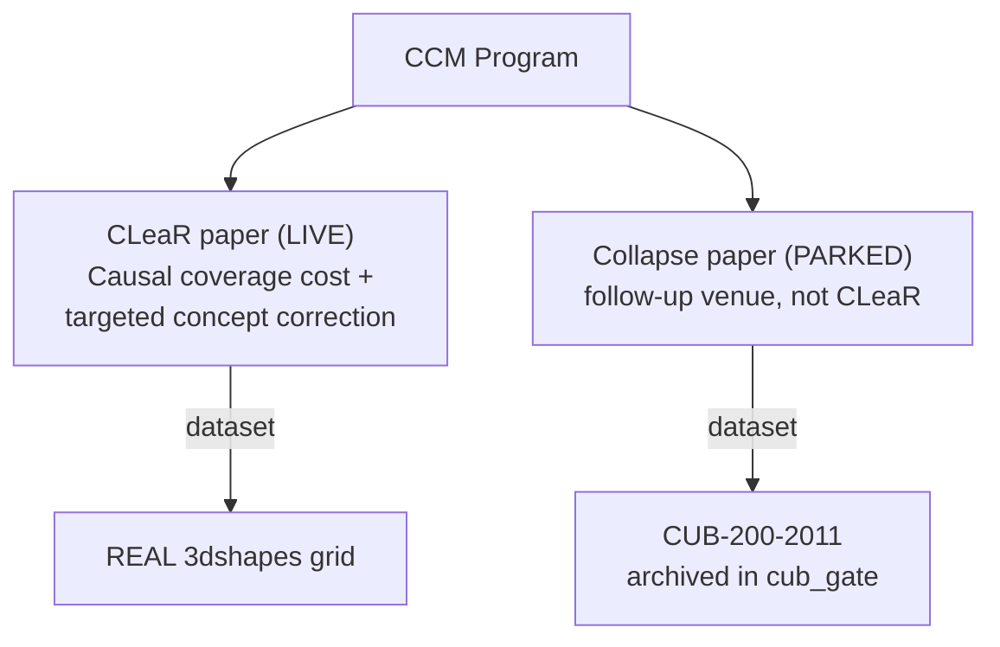

# ✂️ Paper Program — CLeaR ONLY (2026-11-13: NOT submitting to CVPR)

> [!IMPORTANT] Single-paper program (2026-11-13, user decision)
> The user confirmed they are **not submitting to CVPR 2027** (registration was never recorded; the 10 Nov deadline passed). **Everything now targets CLeaR 2027** — full paper **16 Nov 2026, 11:59 pm AoE**. The collapse/CUB arm is **parked as a follow-up paper** (its story and results stay archived; nothing from it goes into the CLeaR submission). The CLeaR draft lives in `paper/main.tex` (+ `refs.bib`, README).

## 1. The split

| | **CLeaR** | **CVPR** |
| :--- | :--- | :--- |
| **Question** | Does the predictor use information outside the declared concepts? | Can we quantify uncertainty over the whole concept vector efficiently? |
| **Dataset** | Shapes3D (replicate on MPI3D; factor list to verify) | CUB-200-2011 |
| **Concepts** | Five factors as categorical concepts; the sixth (a background hue) is the hidden nuisance $U$ | 112 class-denoised attributes (primary), 312 raw (secondary) |
| **Models** | CNN CBM; CNN CBM with residual channel; black-box reference | Frozen DINOv2-base; linear concept head; linear label head on predicted concepts |
| **Gate** | A diagnostic that adds something beyond ordinary sensitivity | An efficiency gain beyond a global joint score and beyond the induced baseline |

Theory each paper leans on:

- CLeaR → [[01 - Literature & Theory/Leakage One-Sided Claim|Leakage: the One-Sided Claim]]
- CVPR → [[01 - Literature & Theory/Joint Concept Coverage|Joint Concept Coverage]]

## 2. Explicitly out of scope (first study)

- **Matryoshka / nested concept budgets** (arXiv:2605.20612). It answers a *concept-budget* question, and its label sets are not comparable with concept-vector sets. Kept out of the first study.
- **Nested conformal sets with adaptive stopping** are already covered by selection-safe conformal early exit (arXiv:2610.20773) — do not reinvent.

## 3. Submission status (updated 2026-11-13)

**CLeaR 2027: LIVE** — gate passed (D7), story current, draft at `paper/main.tex`, deadline 16 Nov AoE.
**CVPR 2027: NOT SUBMITTING** (user decision; registration never completed). The CUB collapse work is a follow-up paper.

---

## 🔗 Related Notes
- [[06 - Papers & Planning/Story - CLeaR Leakage Paper|Story: CLeaR Leakage Paper]] · [[06 - Papers & Planning/Story - CVPR Collapse Paper|Story: CVPR Collapse Paper]]
- [[06 - Papers & Planning/Results Snapshot 2026-11-13|Results Snapshot (canonical)]]
- [[06 - Papers & Planning/Open Decisions|Open Decisions]]
- [[06 - Papers & Planning/Roadmap and Gates|Roadmap and Gates]]
