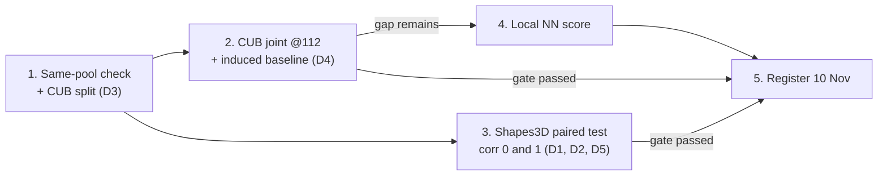

# 🗺️ Roadmap and Gates

Ordered next steps for the two-paper program. **Every step has a gate** — a step is not "done" until its gate question is answered, and only gated results go into a paper.

## 📅 Deadlines

| Deadline | Date | Status |
| :--- | :--- | :--- |
| **CVPR 2027 paper registration** | **10 Nov 2026** | ⚠️ **PASSED — registration status not recorded anywhere in the vault; confirm.** If not registered, the 16 Nov CVPR submission is moot and CLeaR becomes the only live target |
| **CVPR 2027 full paper submission** | **16 Nov 2026 (AoE)** | |
| **CLeaR 2027 submission** | **16 Nov 2026, 11:59 pm AoE** — ✅ **verified 2026-11-11** via the official CfP (cclear.cc/2027/CallforPapers), RIKEN AIP, and @Conf_CLeaR. **There is NO extension to 22 Dec** — earlier reports were wrong. Notification 22 Feb 2027; conference 3–5 May 2027, Paris | 🔴 **3 days out (as of 2026-11-13).** The old sequential plan (CVPR first, CLeaR with five extra weeks) is dead — both fall on the same day |

> The earlier plan's gate dates (3 Nov go/no-go) assumed a 29 Oct start and **have moved**. Do not resurrect them. The "CLeaR extended to 22 Dec" rumor checked out **false** on 2026-11-11.

## Steps, in order

| # | Step | Gate | Depends on |
| :---: | :--- | :--- | :--- |
| **1** | ✅ **DONE (2026-11-06)** — same-pool check run. Outcome: the 95.2% was the **empty-set fill** (+6.0 pts), not shift; no-fill coverage nominal under every protocol; D3 settled (same-distribution cal, no-fill, state label source). [[04 - Results Logs/cub_gate_20261106\|Run report]] | ~~shift~~ ⟹ **fill-empty-with-top-1** explains it | — |
| **2** | ✅ **RUN (2026-11-06)** — full comparison incl. induced baseline and $(m{+}1)$-th largest. **GATE FAILS as framed**: induced 8.5 ambiguous vs 55.3/57.8 at matched 0.90 joint coverage; induced joint coverage ≡ label coverage. Raw-312 frontier computed (guarantee exact at all m). [[04 - Results Logs/cub_gate_20261106\|Run report]]. **D4 settled 2026-11-11 via [[06 - Papers & Planning/Story - CVPR Collapse Paper\|the CVPR story]]** (collapse on denoised / $(m{+}1)$ on raw) | ❌ Global score does **not** beat induced ⟹ **reframed as the collapse finding** (story accepted 2026-11-11) | D3 ✅, D4 ✅ |
| **3** | ▶️ **IN PROGRESS (2026-11-11)** — D1, D2, D5 settled; generator built (procedural fixture + **real 3dshapes** implementation); **first real grid executed**: [[04 - Results Logs/CLeaR_Paired_Pilot_clear_paired_shapes3d_real_20261111_094725\|run log]] — Test-2 signal 0.9+ vs ρ=0 nulls ≤0.056, T1 attribution textbook, sanity null exactly 0, ρ=0 CBM de-saturated (0.834 acc, sets 1.36). Story: [[06 - Papers & Planning/Story - CLeaR Leakage Paper\|CLeaR story]]. **Remaining:** the gate itself — **D7 recommendation (2026-11-13):** reframe as the causal coverage-cost question (directional loss / wrong-scale substitution / paired-max restoration) and run the plain-CBM dose-response ρ ∈ {0, 0.5, 1} with ordinary vs paired-max calibration; machinery now in the library (scene-level splits, `calibrate_paired`, cost readouts) | ~~Does the set-based test detect something the probability change does not?~~ ⟹ **D7: does the wall flip cost the model the correct answer, and can paired calibration restore it?** | ~~D1, D2, D5~~ ✅ |
| **4** | Build the **local nearest-neighbour score** | *Only if step 2 leaves a gap* — otherwise skip | Step 2 |
| **5** | **Register the paper that passed its gate**; treat the other as a secondary target | One gate passed ⟹ that paper registers (10 Nov) | Steps 2–3 |

## Reading the gates

- **CVPR gate (step 2):** an *efficiency* claim — the proposed joint score must beat both the global max score and the induced baseline at matched joint coverage ([[06 - Papers & Planning/Paper Split - CLeaR vs CVPR|Paper Split]]).
- **CLeaR gate (step 3):** a *diagnostic* claim — the set-based intervention test must detect dependence on information outside the declared concepts **that an ordinary probability-sensitivity test misses** ([[01 - Literature & Theory/Leakage One-Sided Claim|Leakage: the One-Sided Claim]] §4).

---

## 🔗 Related Notes
- [[06 - Papers & Planning/Paper Split - CLeaR vs CVPR|Paper Split: CLeaR vs CVPR]]
- [[06 - Papers & Planning/Open Checks|Open Checks]] · [[06 - Papers & Planning/Open Decisions|Open Decisions]]
- [[06 - Papers & Planning/Results Snapshot 2026-11-13|Results Snapshot 2026-11-13 (canonical)]] · [[06 - Papers & Planning/Results Snapshot 2026-11-06|2026-11-06 (archive)]]
