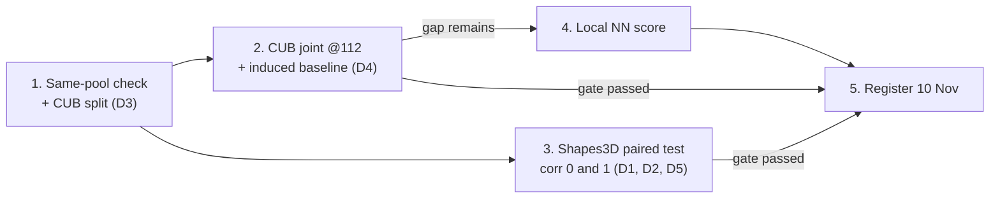

# 🗺️ Roadmap and Gates

Ordered next steps for the two-paper program. **Every step has a gate** — a step is not "done" until its gate question is answered, and only gated results go into a paper.

## 📅 Deadlines

| Deadline | Date | Status |
| :--- | :--- | :--- |
| **CVPR 2027 paper registration** | **10 Nov 2026** | 🔒 Fixed point on the calendar |
| **CVPR 2027 full paper submission** | **16 Nov 2026 (AoE)** | |
| **CLeaR deadline** | ❓ **NOT CHECKED** | Action: look it up before committing the CLeaR arm to a schedule |

> The earlier plan's gate dates (3 Nov go/no-go) assumed a 29 Oct start and **have moved**. Do not resurrect them; anchor everything to registration on **10 Nov**.

## Steps, in order

| # | Step | Gate | Depends on |
| :---: | :--- | :--- | :--- |
| **1** | ✅ **DONE (2026-11-06)** — same-pool check run. Outcome: the 95.2% was the **empty-set fill** (+6.0 pts), not shift; no-fill coverage nominal under every protocol; D3 settled (same-distribution cal, no-fill, state label source). [[04 - Results Logs/cub_gate_20261106\|Run report]] | ~~shift~~ ⟹ **fill-empty-with-top-1** explains it | — |
| **2** | ✅ **RUN (2026-11-06)** — full comparison incl. induced baseline and $(m{+}1)$-th largest. **GATE FAILS as framed**: induced 8.5 ambiguous vs 55.3/57.8 at matched 0.90 joint coverage; induced joint coverage ≡ label coverage. Raw-312 frontier computed (guarantee exact at all m). [[04 - Results Logs/cub_gate_20261106\|Run report]] | ❌ Global score does **not** beat induced ⟹ **reframe before 10 Nov registration** (collapse finding / raw-annotation setting / methodology) | D3 ✅, D4 open |
| **3** | Answer the CLeaR design questions (D1, D2, D5); run the Shapes3D **paired test at training correlation 0 and 1** | Does the **set-based test detect something the probability change does not**? | D1, D2, D5 |
| **4** | Build the **local nearest-neighbour score** | *Only if step 2 leaves a gap* — otherwise skip | Step 2 |
| **5** | **Register the paper that passed its gate**; treat the other as a secondary target | One gate passed ⟹ that paper registers (10 Nov) | Steps 2–3 |

## Reading the gates

- **CVPR gate (step 2):** an *efficiency* claim — the proposed joint score must beat both the global max score and the induced baseline at matched joint coverage ([[06 - Papers & Planning/Paper Split - CLeaR vs CVPR|Paper Split]]).
- **CLeaR gate (step 3):** a *diagnostic* claim — the set-based intervention test must detect dependence on information outside the declared concepts **that an ordinary probability-sensitivity test misses** ([[01 - Literature & Theory/Leakage One-Sided Claim|Leakage: the One-Sided Claim]] §4).

---

## 🔗 Related Notes
- [[06 - Papers & Planning/Paper Split - CLeaR vs CVPR|Paper Split: CLeaR vs CVPR]]
- [[06 - Papers & Planning/Open Checks|Open Checks]] · [[06 - Papers & Planning/Open Decisions|Open Decisions]]
- [[06 - Papers & Planning/Results Snapshot 2026-11-06|Results Snapshot]]
